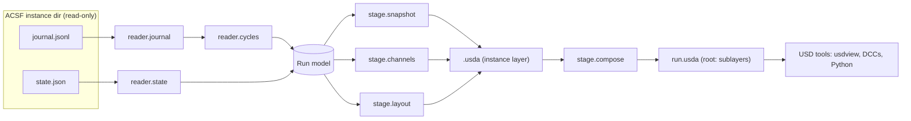

# Architecture

ACSF references are pinned to commit
[`64486d9`](https://github.com/Preponderous-Software/artificial-consciousness-simulation-framework/tree/64486d9c580325df33f03e8cb20dc7b8a227189a).
Read [CONCEPT.md § What ACSF's "environment" actually is](./CONCEPT.md#what-acsfs-environment-actually-is)
first: everything below follows from ACSF having no spatial world.

## Integration decision: standalone tool, not an ACSF plugin

The exporter is a **separate Python package and CLI that reads ACSF's on-disk artifacts**.
It does not run inside an ACSF process.

Reasons, each checked against ACSF's code:

1. **ACSF has no plugin registry.** Perception providers are built by a closed
   `if/elif` over `"wikipedia"` and `"mock"` that raises on anything else
   ([`llm/perception.py` L247–L258](https://github.com/Preponderous-Software/artificial-consciousness-simulation-framework/blob/64486d9c580325df33f03e8cb20dc7b8a227189a/consciousness-sim/llm/perception.py#L247-L258)).
   The in-process event hooks (`on_thought`, `on_perception`, … —
   [`core/consciousness.py` L556–L565](https://github.com/Preponderous-Software/artificial-consciousness-simulation-framework/blob/64486d9c580325df33f03e8cb20dc7b8a227189a/consciousness-sim/core/consciousness.py#L556-L565))
   are only reachable by code constructed inside `Consciousness.__init__`, which is how the
   Discord sink is wired (L590–L594). Any in-process exporter would need an ACSF change first.
2. **ACSF already has an out-of-process read contract.** Its web dashboard "owns no
   consciousness — it discovers running instances by scanning `CONSCIOUSNESS_HOME` and tails
   their append-only journals"
   ([`consciousness-sim/README.md` L156](https://github.com/Preponderous-Software/artificial-consciousness-simulation-framework/blob/64486d9c580325df33f03e8cb20dc7b8a227189a/consciousness-sim/README.md#L156)),
   and the structured `cycle` event (#196) was added precisely so out-of-process readers can
   see a cycle's internals
   ([`_journal_cycle_trace` L629–L635](https://github.com/Preponderous-Software/artificial-consciousness-simulation-framework/blob/64486d9c580325df33f03e8cb20dc7b8a227189a/consciousness-sim/core/consciousness.py#L629-L635)).
   This tool is one more such reader.
3. **Recorded runs are files.** Experiment run directories and the committed golden runs are
   `journal.jsonl` + `state.json` pairs with no process to attach to
   ([`experiments/runner.py`](https://github.com/Preponderous-Software/artificial-consciousness-simulation-framework/blob/64486d9c580325df33f03e8cb20dc7b8a227189a/consciousness-sim/experiments/runner.py)).
   A file reader handles live, stopped and archived runs the same way.
4. **Dependency weight and licensing stay out of ACSF.** `usd-core` is a large native wheel
   under a non-MIT license (TOST 1.0). Keeping it in a separate package means an ACSF
   install never pulls it in.
5. **Zero risk to instance data.** A read-only reader cannot corrupt a running instance's
   state. The exporter opens ACSF files read-only and writes only to its own output path.

The cost: a batch export lags a live run by however often it is re-run (`--follow` narrows
that to one poll interval, see [Live mode](#live-mode-follow)), and per-cycle mood history is
available only from journals in which ACSF records it (see [Decisions](#decisions)).

## Direction of sync

| Direction | MVP | Notes |
|---|---|---|
| **ACSF → USD** (export, playback) | **Yes** | Batch export of a finished or running instance; re-runnable. `--follow` keeps one instance's stage current as cycles happen (milestone 9). |
| **USD → ACSF** (load environment) | **No — design note only** | Needs an ACSF change; see below. |

**Why import is not in the MVP.** "Loading an ACSF environment from USD" has nothing to load
into: an instance's only environmental inputs are the perception provider and the inbox, and
its only outward action is an utterance. A USD scene could still be *perceived*: the smallest
ACSF extension would be

1. a provider registry (or one more branch) in `build_perception_provider`, and
2. a `UsdScenePerception(PerceptionProvider)` whose `fetch()` returns a `Perception` whose
   `content` is a short text description of a prim chosen from a scene (e.g. one with an
   `acsf:describe` string), honouring the existing contract that providers return `None` on
   failure ([`llm/perception.py` L68–L80](https://github.com/Preponderous-Software/artificial-consciousness-simulation-framework/blob/64486d9c580325df33f03e8cb20dc7b8a227189a/consciousness-sim/llm/perception.py#L68-L80))
   and passing through ACSF's existing perception sanitisation.

That is still text perception of a static scene — not embodiment, and it would not by itself
advance AE-2. Milestone 8 writes this up as a proposal document in this repository
([docs/usd-perception-proposal.md](./docs/usd-perception-proposal.md)) for the
ACSF maintainers to accept or reject; nothing is filed or changed in ACSF by this project.

## Components

```text
acsf_usd/
  reader/       ACSF artifact readers (journal.jsonl, state.json), typed records, cycle indexer
  model.py      In-memory run model: Instance, Cycle, Event, Snapshot
  stage/        USD writers: static snapshot, time-sampled channels, schematic layout, composition
  follow.py     `--follow`: poll journal.jsonl from a byte offset, re-author the instance layer
  validate.py   `acsf-usd validate`: re-read a stage and check it against its source journal
  cli.py        `acsf-usd export [--follow] [--binary] | validate | describe`
tests/
  fixtures/     Small synthetic journals + states; golden-run copies pinned to an ACSF SHA
```

| Component | Responsibility |
|---|---|
| `reader.journal` | Stream `journal.jsonl`; skip blank, corrupt and non-object lines with a warning, as ACSF's own reader does ([`persistence/journal.py` L49–L80](https://github.com/Preponderous-Software/artificial-consciousness-simulation-framework/blob/64486d9c580325df33f03e8cb20dc7b8a227189a/consciousness-sim/persistence/journal.py#L49-L80)). Unknown event types are kept, not rejected. |
| `reader.state` | Load `state.json` (a snapshot dict with `identity`, `short_term`, `thought_count`, optional `health`). A missing or invalid file yields "no snapshot", never an exception that aborts export. |
| `reader.cycles` | Assign every journal event a cycle index (rules below). |
| `stage.snapshot` | Author non-time-varying data: identity, final mood, final attention schema, final workspace. |
| `stage.channels` | Author time-sampled string/float/token attributes per event channel. |
| `stage.layout` | Author the schematic geometry and per-cycle visibility. |
| `stage.compose` | One layer per instance; a root layer that sublayers them for multi-instance views. |
| `follow` | Live mode for one instance: incremental, read-only journal polling; atomic re-write of the output layer (see [Live mode](#live-mode-follow)). |
| `validate` | Recompute, from the indexed journal and independently of the channel writer, what every text channel (`acsf:thought`, `acsf:reflection`, `acsf:perception`, each interlocutor's `acsf:utterance`) must hold on every cycle, and compare byte-for-byte; also check `acsf:cycleIndexing`. Works on `.usda`, `.usdc` and composed root stages. |
| `cli` | Resolve input (instance name under `CONSCIOUSNESS_HOME`, an instance dir, a run dir, or a `CONSCIOUSNESS_HOME`), write `.usda` (default) or `.usdc` (`--binary`), validate. |

### Cycle indexing rules

USD time code **t = ACSF cycle number** (`thought_count`), so the timeline is the axis ACSF's
metrics already use.

1. If a `cycle` event is present, its `thought_count` is authoritative for the events of that
   cycle: the preceding `perception` and `thought` and the following `utterance`,
   `reflection`, `identity_shift` and `memory` events (write order in
   [`core/consciousness.py` L956–L1011](https://github.com/Preponderous-Software/artificial-consciousness-simulation-framework/blob/64486d9c580325df33f03e8cb20dc7b8a227189a/consciousness-sim/core/consciousness.py#L956-L1011)).
   In a journal that has `cycle` events, a cycle without one (for example a stretch written
   before #196) is numbered one past the previous cycle.
   A `cycle` event also bounds its cycle on its own, so a corrupt (skipped) `thought` line
   never merges two journaled cycles.
2. Journals without `cycle` events (written before #196 — e.g. the committed golden runs,
   which contain only `thought`, `perception` and `reflection`) fall back to counting
   `thought` events: a `perception` belongs to the next `thought`; everything after a
   `thought` up to the next `perception`/`thought` belongs to it. Failed cycles increment
   `thought_count` but write no `thought`, so in this mode indices can undercount; the stage
   records `acsf:cycleIndexing = "counted"` vs `"journaled"`.
3. `consolidation` events come from a background timer, not a cycle; they are attached to
   the most recent cycle and flagged `background` (to the first cycle if none has completed
   yet; to cycle 0 in a journal with no cycles at all).
4. Wall-clock `timestamp` strings are kept as a time-sampled attribute, not used as time codes.

## Data flow



## ACSF → USD mapping

Stage metadata: `defaultPrim = "World"`, `upAxis = "Y"`, `metersPerUnit = 1`,
`startTimeCode` = first cycle, `endTimeCode` = last cycle, `timeCodesPerSecond` = 1 by default
(one cycle per second of playback; configurable). The stage's custom metadata (the root
layer's `customLayerData`) records `acsf:sourceCommit` (if known), `acsf:exporterVersion`,
`acsf:cycleIndexing`, `acsf:layout:synthetic = true`. All custom attributes use the `acsf:`
namespace. Values listed as float are authored as USD `double`, so journal numbers survive
unrounded.

| ACSF source | USD prim path | Prim type | Attribute(s) | Time-sampled? |
|---|---|---|---|---|
| Stage root | `/World` | `Xform` | — | — |
| Instance (directory name; characters outside `[A-Za-z0-9_]` become `_` and a leading digit gets a `_` prefix) | `/World/Instances/<name>` | `Xform` | `acsf:name` (string; the unaltered directory name) | no |
| `state.json identity.{origin_story, purpose, self_concept, values, personality_traits, amendments}` | `/World/Instances/<name>/Identity` | typeless | `acsf:identity:originStory`, `acsf:identity:purpose`, `acsf:identity:selfConcept` (string); `acsf:identity:values`, `acsf:identity:personalityTraits`, `acsf:identity:amendments` (string[]) | no (snapshot) |
| `cycle.mood.<dim>` when present ([ACSF #220](https://github.com/Preponderous-Software/artificial-consciousness-simulation-framework/issues/220)); otherwise `state.json identity.mood.<dim>` | `/World/Instances/<name>/Mood` | typeless | `acsf:mood:<dim>` (float; `<dim>` sanitised like a prim name, with `_2`, `_3` … when two dimensions sanitise alike — one mapping shared with `acsf:moodBaseline:<dim>`) | yes when `cycle` events carry `mood`; otherwise **no** — final value only |
| `state.json identity.initial_mood.<dim>` | same | — | `acsf:moodBaseline:<dim>` (float) | no (snapshot) |
| `cycle.attention.{focus, theme, salience}` (fallback: `state.json identity.attention_schema`) | `/World/Instances/<name>/Attention` | typeless | `acsf:focus` (token), `acsf:theme` (string), `acsf:salience` (float) | yes (when `cycle` events exist) |
| `cycle.{metacognitive_label, prediction.error, reflection.effective, reflection.fired, short_term_size}`, `len(cycle.retrieved)` | `/World/Instances/<name>/Cycle` | typeless | `acsf:hot2Label` (token), `acsf:predictionError` (float), `acsf:reflectionP` (float), `acsf:reflectionFired` (bool), `acsf:workspaceSize` (int), `acsf:retrievedCount` (int; count only, never the summaries) | yes |
| `thought` event | `/World/Instances/<name>/Stream` | typeless | `acsf:thought` (string) | yes (held) |
| `reflection` event | same | — | `acsf:reflection` (string; empty when none this cycle) | yes |
| `perception` event (incl. `speech`) | `/World/Instances/<name>/Stimulus` | `Xform` + child `Sphere` | `acsf:perception` (string), `acsf:perceptionSource` (token: `wikipedia`/`mock`/`speech`), `visibility` | yes |
| `utterance` event (`to`, `in_reply_to`) | `/World/Instances/<name>/Interlocutors/<sender>` (`<sender>` = the utterance's `to`, the person whose message was answered) | `Xform` + child `Cube` | `acsf:sender` (string, unaltered name; not sampled), `acsf:utterance`, `acsf:inReplyTo` (string), `visibility` | yes |
| `identity_shift` event | `/World/Instances/<name>/Identity` | — | `acsf:selfConcept` (string) | yes |
| `memory.long_term_count`, `consolidation.{long_term_total, stored}` | `/World/Instances/<name>/Memory` | typeless | `acsf:longTermCount` (int; the latest `long_term_count` / `long_term_total` in the cycle), `acsf:consolidationStored` (int; stored in that cycle, 0 when none) — counts only, no memory text | yes |
| `state.json short_term[]` (`kind`, `content`, `timestamp`, `importance`, `seq`) | `/World/Instances/<name>/Workspace/Item_<seq>` (`Item_<position>` for every item when any `seq` is missing or repeated — the golden runs' `state.json` files have none) | typeless | `acsf:kind` (token), `acsf:content` (string), `acsf:importance` (float), `acsf:timestamp` (string) | no (final snapshot) |
| journal `timestamp` | `/World/Instances/<name>/Stream` | — | `acsf:timestamp` (string, ISO-8601) | yes |
| Unknown event type `<t>` | `/World/Instances/<name>/Stream` | — | `acsf:event:<t>` (string, `content`; `<t>` sanitised and disambiguated like interlocutor names) | yes |

**Sampling rules.** The timeline is every integer cycle from the first to the last journaled
one, including failed cycles that journaled nothing. String and token channels (`Stream`,
`Stimulus`, `Interlocutors/*`) get a sample on every cycle of the timeline — the cycle's value, or `""` when the channel has no
event that cycle — so a held string never carries over into a later cycle; `Memory`'s
`acsf:consolidationStored` likewise has a sample (possibly 0) on every cycle. Values that
describe a state rather than an event (`Cycle`, `Attention`, `Mood` when journaled,
`acsf:longTermCount`, `Identity.acsf:selfConcept`) are sampled only on cycles whose events
carry them; `acsf:selfConcept` additionally holds `""` on the first cycle when the first
`identity_shift` comes later, because USD holds the first sample backwards in time. Several
events of one channel in one cycle are joined with a newline. `acsf:timestamp` is the cycle's
`thought` time (else its first event's). `acsf:perceptionSource` is the `<source>` in the
`"[<source>: <title>] …"` prefix ACSF writes into a perception's `content`
([`core/consciousness.py` L954–L956](https://github.com/Preponderous-Software/artificial-consciousness-simulation-framework/blob/64486d9c580325df33f03e8cb20dc7b8a227189a/consciousness-sim/core/consciousness.py#L954-L956)).
Interlocutor prim names are sanitised like instance names, disambiguated deterministically
(`_2`, `_3`, … in sorted order of the raw names).

Strings, tokens and bools are not interpolated by USD: a value held at cycle *n* stays until
the next sample (verified with `usd-core` 26.8: a string sampled at t=0 and t=1 resolves to
the t=1 value at t=1.5). Floats are authored at integer time codes only.

**Schematic layout (synthetic).** The instance sits at its own origin; the `Stimulus` sphere
(radius 0.4, 1.5 units above the origin) is visible (`visibility = inherited`) only on cycles
with a perception and `invisible` on every other cycle; each interlocutor cube (size 0.5) is
placed on a ring of radius 3 in the XZ plane around the instance — the angle comes from the
SHA-256 of the sender name, and coordinates are rounded to 6 decimals so they are identical
across runs and machines — and is visible on cycles with an utterance to it. Every geometry
prim carries `doc` metadata saying it is synthetic. Multiple instances are offset along X.
These positions encode nothing ACSF knows and must never be read as such.

## Multi-instance composition

`acsf-usd export` takes one or more inputs. An input may also be a directory holding instance
directories — a whole `CONSCIOUSNESS_HOME`, or an experiment run with `replicate-<i>/`
subdirectories. One instance gives one layer. Several (or any directory of instances) give
one layer per instance, written next to the root layer (`-o`, default `run.usda`), plus a root
layer whose `subLayerPaths` list them in prim-name order. Each instance layer is the same
file a single-instance export writes, so it opens on its own. The root layer holds what
belongs to the group:

- `startTimeCode` / `endTimeCode` spanning every instance, so all of them share one timeline;
- `timeCodesPerSecond`, `defaultPrim`, `upAxis`, `metersPerUnit`;
- an `over` per instance translating it `10 × i` along X (part of the synthetic layout);
- `customLayerData` with `acsf:exporterVersion`, `acsf:layout:synthetic = true` and
  `acsf:instanceCount`.

Per-instance `acsf:cycleIndexing` and `acsf:moodSampling` stay in each instance layer.

Two inputs whose names sanitise to the same prim name are ranked by (prim name, raw name,
resolved source path). The first keeps the name and later ones get `_2`, `_3` …, so the
result does not depend on argument order. `acsf:name` keeps the raw name. A root path that
would overwrite an instance layer is a usage error.

## Live mode (follow)

`acsf-usd export <instance> -o <file> --follow` exports the journal as it stands, then keeps
the output current as the instance runs. It follows **one** instance; multi-instance
composition stays batch-only.

- **Polling, like ACSF's own tailer.** Every 0.5 s (configurable) the size of
  `journal.jsonl` is compared with a byte offset; new bytes are read from a handle opened
  `"rb"`. Only complete lines are consumed — a partial trailing line waits for the next poll —
  and a file that shrank is re-read from offset 0. This mirrors the dashboard tailer
  ([`interfaces/web/journal_tail.py` L9–L10, L107–L164](https://github.com/Preponderous-Software/artificial-consciousness-simulation-framework/blob/64486d9c580325df33f03e8cb20dc7b8a227189a/consciousness-sim/interfaces/web/journal_tail.py#L107-L164)),
  so no file-watching dependency is added.
- **Appending time samples.** New events go through the same cycle indexer as a batch
  export and extend the in-memory run model. USD layers are not appended in place, so the
  instance layer is re-authored from the model and written to a temporary file next to the
  output, then moved over it with `os.replace` — a USD tool never sees a half-written file.
  `state.json` is re-read on each write; if it is missing or unparseable at that moment (it
  is overwritten on every save), the previous snapshot is kept.
- **Strictly read-only.** Instance files are only ever opened for reading; no lock, sidecar,
  offset file or temporary file is created in the instance directory, and an output path
  inside any input directory is refused. Offsets live in memory only.
- **Same result as batch.** On SIGINT/SIGTERM a final write is made and the command exits
  0. The final output is byte-identical to a batch export of the same journal bytes and
  `state.json`, so `validate` and the determinism check apply unchanged.

## Dependencies

| Dependency | Version | Why |
|---|---|---|
| Python | ≥ 3.11 | Matches ACSF's `requires-python = ">=3.11"` ([`pyproject.toml` L10](https://github.com/Preponderous-Software/artificial-consciousness-simulation-framework/blob/64486d9c580325df33f03e8cb20dc7b8a227189a/consciousness-sim/pyproject.toml#L10)); `usd-core` 26.8 supports `>=3.9,<3.15`. |
| [`usd-core`](https://pypi.org/project/usd-core/) | `==26.8` (released 2026-07-20) | The `pxr` Python bindings (`Usd`, `UsdGeom`, `Sdf`, `Gf`). License: Tomorrow Open Source Technology License 1.0 (Apache-2.0 derived, differs in §6 Trademarks — see [OpenUSD LICENSE.txt](https://github.com/PixarAnimationStudios/OpenUSD/blob/release/LICENSE.txt)). No `usdview`. |
| ACSF | none at runtime | Only its file formats are read; it is **not** imported. Fixtures are pinned to ACSF commit `64486d9`. |
| `pytest` | `>=9.1` (dev) | Tests. |
| `mypy` | `>=2.4` (dev) | Strict typing, mirroring ACSF's CI. |
| `ruff` | `>=0.17` (dev) | Lint/format. |

## Testing strategy

- **Unit — readers:** synthetic journals covering every event type ACSF writes, corrupt lines,
  non-object lines, a journal with and without `cycle` events, a missing/corrupt `state.json`.
- **Unit — cycle indexing:** hand-built sequences asserting each event's index under both
  rules, including a failed cycle (gap in `thought_count`).
- **Stage assertions:** open the exported stage with `Usd.Stage.Open`, assert prim paths,
  attribute types, `GetTimeSamples()` equal the expected cycle set, and the text at each
  sample equals the journal `content` byte-for-byte.
- **Golden-run end-to-end:** copies of ACSF's committed golden runs
  (`consciousness-sim/experiments/golden/{Echo,Rafael,Sage,Wren}/`, MIT, attributed and
  pinned to `64486d9`) exported in CI; e.g. Echo yields 200 `acsf:thought` samples and 67
  non-empty `acsf:perception` samples (counts taken from that file at that commit).
- **Read-only guarantee:** the export test snapshots the input directory's file hashes and
  mtimes before and after and asserts no change.
- **Determinism:** exporting the same input twice produces byte-identical `.usda`.
- **Follow mode:** a test appends journal lines (including one line flushed in two writes)
  to a temporary instance while `--follow` runs, asserts the output gains samples, and asserts
  the final output equals a batch export of the same files; the instance directory gains no
  files other than the test's own writes.
- **CI:** GitHub Actions, Python 3.11 and 3.13, `pytest`, `mypy`, `ruff`. No network; no LLM.

## Decisions

Recorded 2026-10-17. Each entry resolves a question that was previously listed under
[Open questions](#open-questions).

1. **Mood history: time samples when ACSF journals mood, final value otherwise.** An
   upstream issue proposes adding the current `mood` to ACSF's per-cycle `cycle` event
   ([ACSF #220](https://github.com/Preponderous-Software/artificial-consciousness-simulation-framework/issues/220)). The exporter does not depend on it: when `cycle` events carry
   `mood`, each `acsf:mood:<dim>` gets one time sample per such cycle and the stage
   `customLayerData` records `acsf:moodSampling = "journaled"` plus `acsf:moodFirstCycle` (the
   first cycle that carried it, since journals written before the change have none). When no
   `cycle` event carries `mood` — every journal written today, including the golden runs —
   mood is authored as the single final value from `state.json` and
   `acsf:moodSampling = "final"`. Nothing in this repository changes ACSF.
2. **Live mode: `acsf-usd export --follow`, added to the MVP as milestone 9.** It stays in
   the MVP because it is small and adds no new trust boundary: it reuses the readers,
   indexer and stage writers of milestones 2–4, uses stdlib polling (no new dependency) and
   follows one instance only. Details in [Live mode](#live-mode-follow). It is strictly
   read-only against the instance directory.
3. **Long-term memory: counts only.** Per-cycle counts come from the journal — `memory`
   events' `long_term_count` and `consolidation` events' `long_term_total` / `stored` — and
   the number of memories retrieved in a cycle is `len(cycle.retrieved)`. No memory text is
   written to any USD file: not the `cycle.retrieved[].summary` strings, not `memory.db`
   rows. `memory.db` is never opened.
4. **Output format: `.usda` by default, `--binary` for `.usdc`.** Text is the default
   because it is diffable and is what the determinism and fidelity checks compare.
   `--binary` writes `.usdc` (USD's binary crate format) for long runs. The flag, not the
   `-o` extension, selects the format; an `-o` path whose extension contradicts it is a
   usage error. In multi-instance export the per-instance layers and the root layer all use
   the selected format. `acsf-usd validate` reads either.

## Open questions

The questions on mood history, live mode, long-term memory and output format were resolved
on 2026-10-17 and moved to [Decisions](#decisions).

1. **Timeline unit.** Cycle index (default) vs. wall-clock seconds since first event — offer
   both, or keep wall-clock as data only?
2. **Workspace history.** The short-term buffer is only available as a final snapshot;
   reconstructing it per cycle from the journal would be an approximation. Worth it?
3. **Import direction.** Does the ACSF side want a USD-scene perception provider at all? The
   design note ([docs/usd-perception-proposal.md](./docs/usd-perception-proposal.md), milestone 8)
   is the input to that decision.
