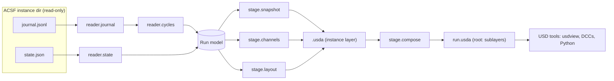

# Architecture

ACSF references are pinned to commit
[`64486d9`](https://github.com/Preponderous-Software/artificial-consciousness-simulation-framework/tree/64486d9c580325df33f03e8cb20dc7b8a227189a).
Read [CONCEPT.md § What ACSF's "environment" actually is](./CONCEPT.md#what-acsfs-environment-actually-is)
first: everything below follows from ACSF having no spatial world.

## Integration decision: standalone tool, not an ACSF plugin

The exporter is a **separate Python package and CLI that reads ACSF's on-disk artifacts**.
It does not run inside an ACSF process.

Reasons, each checked against ACSF's code:

1. **ACSF has no plugin registry.** Perception providers are built by a closed
   `if/elif` over `"wikipedia"` and `"mock"` that raises on anything else
   ([`llm/perception.py` L247–L258](https://github.com/Preponderous-Software/artificial-consciousness-simulation-framework/blob/64486d9c580325df33f03e8cb20dc7b8a227189a/consciousness-sim/llm/perception.py#L247-L258)).
   The in-process event hooks (`on_thought`, `on_perception`, … —
   [`core/consciousness.py` L556–L565](https://github.com/Preponderous-Software/artificial-consciousness-simulation-framework/blob/64486d9c580325df33f03e8cb20dc7b8a227189a/consciousness-sim/core/consciousness.py#L556-L565))
   are only reachable by code constructed inside `Consciousness.__init__`, which is how the
   Discord sink is wired (L590–L594). Any in-process exporter would need an ACSF change first.
2. **ACSF already has an out-of-process read contract.** Its web dashboard "owns no
   consciousness — it discovers running instances by scanning `CONSCIOUSNESS_HOME` and tails
   their append-only journals"
   ([`consciousness-sim/README.md` L156](https://github.com/Preponderous-Software/artificial-consciousness-simulation-framework/blob/64486d9c580325df33f03e8cb20dc7b8a227189a/consciousness-sim/README.md#L156)),
   and the structured `cycle` event (#196) was added precisely so out-of-process readers can
   see a cycle's internals
   ([`_journal_cycle_trace` L629–L635](https://github.com/Preponderous-Software/artificial-consciousness-simulation-framework/blob/64486d9c580325df33f03e8cb20dc7b8a227189a/consciousness-sim/core/consciousness.py#L629-L635)).
   This tool is one more such reader.
3. **Recorded runs are files.** Experiment run directories and the committed golden runs are
   `journal.jsonl` + `state.json` pairs with no process to attach to
   ([`experiments/runner.py`](https://github.com/Preponderous-Software/artificial-consciousness-simulation-framework/blob/64486d9c580325df33f03e8cb20dc7b8a227189a/consciousness-sim/experiments/runner.py)).
   A file reader handles live, stopped and archived runs the same way.
4. **Dependency weight and licensing stay out of ACSF.** `usd-core` is a large native wheel
   under a non-MIT license (TOST 1.0). Keeping it in a separate package means an ACSF
   install never pulls it in.
5. **Zero risk to instance data.** A read-only reader cannot corrupt a running instance's
   state. The exporter opens ACSF files read-only and writes only to its own output path.

The cost: export lags a live run by however often it is re-run, and per-cycle mood history
is unavailable because ACSF does not journal it (see [Open questions](#open-questions)).

## Direction of sync

| Direction | MVP | Notes |
|---|---|---|
| **ACSF → USD** (export, playback) | **Yes** | Batch export of a finished or running instance; re-runnable. |
| **USD → ACSF** (load environment) | **No — design note only** | Needs an ACSF change; see below. |

**Why import is not in the MVP.** "Loading an ACSF environment from USD" has nothing to load
into: an instance's only environmental inputs are the perception provider and the inbox, and
its only outward action is an utterance. A USD scene could still be *perceived*: the smallest
ACSF extension would be

1. a provider registry (or one more branch) in `build_perception_provider`, and
2. a `UsdScenePerception(PerceptionProvider)` whose `fetch()` returns a `Perception` whose
   `content` is a short text description of a prim chosen from a scene (e.g. one with an
   `acsf:describe` string), honouring the existing contract that providers return `None` on
   failure ([`llm/perception.py` L68–L80](https://github.com/Preponderous-Software/artificial-consciousness-simulation-framework/blob/64486d9c580325df33f03e8cb20dc7b8a227189a/consciousness-sim/llm/perception.py#L68-L80))
   and passing through ACSF's existing perception sanitisation.

That is still text perception of a static scene — not embodiment, and it would not by itself
advance AE-2. Milestone 8 writes this up as a proposal document in this repository for the
ACSF maintainers to accept or reject; nothing is filed or changed in ACSF by this project.

## Components

```text
acsf_usd/
  reader/       ACSF artifact readers (journal.jsonl, state.json), typed records, cycle indexer
  model.py      In-memory run model: Instance, Cycle, Event, Snapshot
  stage/        USD writers: static snapshot, time-sampled channels, schematic layout, composition
  cli.py        `acsf-usd export | validate | describe`
tests/
  fixtures/     Small synthetic journals + states; golden-run copies pinned to an ACSF SHA
```

| Component | Responsibility |
|---|---|
| `reader.journal` | Stream `journal.jsonl`; skip blank, corrupt and non-object lines with a warning, as ACSF's own reader does ([`persistence/journal.py` L49–L80](https://github.com/Preponderous-Software/artificial-consciousness-simulation-framework/blob/64486d9c580325df33f03e8cb20dc7b8a227189a/consciousness-sim/persistence/journal.py#L49-L80)). Unknown event types are kept, not rejected. |
| `reader.state` | Load `state.json` (a snapshot dict with `identity`, `short_term`, `thought_count`, optional `health`). A missing or invalid file yields "no snapshot", never an exception that aborts export. |
| `reader.cycles` | Assign every journal event a cycle index (rules below). |
| `stage.snapshot` | Author non-time-varying data: identity, final mood, final attention schema, final workspace. |
| `stage.channels` | Author time-sampled string/float/token attributes per event channel. |
| `stage.layout` | Author the schematic geometry and per-cycle visibility. |
| `stage.compose` | One layer per instance; a root layer that sublayers them for multi-instance views. |
| `cli` | Resolve input (instance name under `CONSCIOUSNESS_HOME`, an instance dir, a run dir, or a `CONSCIOUSNESS_HOME`), write `.usda`/`.usdc`, validate. |

### Cycle indexing rules

USD time code **t = ACSF cycle number** (`thought_count`), so the timeline is the axis ACSF's
metrics already use.

1. If a `cycle` event is present, its `thought_count` is authoritative for the events of that
   cycle: the preceding `perception` and `thought` and the following `utterance`,
   `reflection`, `identity_shift` and `memory` events (write order in
   [`core/consciousness.py` L956–L1011](https://github.com/Preponderous-Software/artificial-consciousness-simulation-framework/blob/64486d9c580325df33f03e8cb20dc7b8a227189a/consciousness-sim/core/consciousness.py#L956-L1011)).
2. Journals without `cycle` events (written before #196 — e.g. the committed golden runs,
   which contain only `thought`, `perception` and `reflection`) fall back to counting
   `thought` events: a `perception` belongs to the next `thought`; everything after a
   `thought` up to the next `perception`/`thought` belongs to it. Failed cycles increment
   `thought_count` but write no `thought`, so in this mode indices can undercount; the stage
   records `acsf:cycleIndexing = "counted"` vs `"journaled"`.
3. `consolidation` events come from a background timer, not a cycle; they are attached to
   the most recent cycle and flagged `background`.
4. Wall-clock `timestamp` strings are kept as a time-sampled attribute, not used as time codes.

## Data flow



## ACSF → USD mapping

Stage metadata: `defaultPrim = "World"`, `upAxis = "Y"`, `metersPerUnit = 1`,
`startTimeCode` = first cycle, `endTimeCode` = last cycle, `timeCodesPerSecond` = 1 by default
(one cycle per second of playback; configurable). Stage `customData` records
`acsf:sourceCommit` (if known), `acsf:exporterVersion`, `acsf:cycleIndexing`,
`acsf:layout:synthetic = true`. All custom attributes use the `acsf:` namespace.

| ACSF source | USD prim path | Prim type | Attribute(s) | Time-sampled? |
|---|---|---|---|---|
| Stage root | `/World` | `Xform` | — | — |
| Instance (directory name) | `/World/Instances/<name>` | `Xform` | `acsf:name` (string) | no |
| `state.json identity.{origin_story, purpose, self_concept, values, personality_traits, amendments}` | `/World/Instances/<name>/Identity` | typeless | `acsf:identity:*` (string / string[]) | no (snapshot) |
| `state.json identity.mood.<dim>` / `initial_mood.<dim>` | `/World/Instances/<name>/Mood` | typeless | `acsf:mood:<dim>`, `acsf:moodBaseline:<dim>` (float) | **no** — final value only; ACSF does not journal mood |
| `cycle.attention.{focus, theme, salience}` (fallback: `state.json identity.attention_schema`) | `/World/Instances/<name>/Attention` | typeless | `acsf:focus` (token), `acsf:theme` (string), `acsf:salience` (float) | yes (when `cycle` events exist) |
| `cycle.{metacognitive_label, prediction.error, reflection.effective, reflection.fired, short_term_size}` | `/World/Instances/<name>/Cycle` | typeless | `acsf:hot2Label` (token), `acsf:predictionError` (float), `acsf:reflectionP` (float), `acsf:reflectionFired` (bool), `acsf:workspaceSize` (int) | yes |
| `thought` event | `/World/Instances/<name>/Stream` | typeless | `acsf:thought` (string) | yes (held) |
| `reflection` event | same | — | `acsf:reflection` (string; empty when none this cycle) | yes |
| `perception` event (incl. `speech`) | `/World/Instances/<name>/Stimulus` | `Xform` + child `Sphere` | `acsf:perception` (string), `acsf:perceptionSource` (token: `wikipedia`/`mock`/`speech`), `visibility` | yes |
| `utterance` event (`to`, `in_reply_to`) | `/World/Instances/<name>/Interlocutors/<sender>` | `Xform` + child `Cube` | `acsf:utterance`, `acsf:inReplyTo` (string), `visibility` | yes |
| `identity_shift` event | `/World/Instances/<name>/Identity` | — | `acsf:selfConcept` (string) | yes |
| `memory` / `consolidation` events | `/World/Instances/<name>/Memory` | typeless | `acsf:longTermCount` (int), `acsf:consolidation` (string) | yes |
| `state.json short_term[]` (`kind`, `content`, `timestamp`, `importance`, `seq`) | `/World/Instances/<name>/Workspace/Item_<seq>` | typeless | `acsf:kind` (token), `acsf:content` (string), `acsf:importance` (float) | no (final snapshot) |
| journal `timestamp` | `/World/Instances/<name>/Stream` | — | `acsf:timestamp` (string, ISO-8601) | yes |
| Unknown event type `<t>` | `/World/Instances/<name>/Stream` | — | `acsf:event:<t>` (string, `content`) | yes |

Strings, tokens and bools are not interpolated by USD: a value held at cycle *n* stays until
the next sample (verified with `usd-core` 26.8: a string sampled at t=0 and t=1 resolves to
the t=1 value at t=1.5). Floats are authored at integer time codes only.

**Schematic layout (synthetic).** The instance sits at its own origin; the `Stimulus` sphere
is visible only on cycles with a perception; each interlocutor cube is placed on a ring around
the instance (angle from a stable hash of the sender name) and visible on cycles with an
utterance to it. Multiple instances are offset along X. These positions encode nothing ACSF
knows and must never be read as such.

## Dependencies

| Dependency | Version | Why |
|---|---|---|
| Python | ≥ 3.11 | Matches ACSF's `requires-python = ">=3.11"` ([`pyproject.toml` L10](https://github.com/Preponderous-Software/artificial-consciousness-simulation-framework/blob/64486d9c580325df33f03e8cb20dc7b8a227189a/consciousness-sim/pyproject.toml#L10)); `usd-core` 26.8 supports `>=3.9,<3.15`. |
| [`usd-core`](https://pypi.org/project/usd-core/) | `==26.8` (released 2026-07-20) | The `pxr` Python bindings (`Usd`, `UsdGeom`, `Sdf`, `Gf`). License: Tomorrow Open Source Technology License 1.0 (Apache-2.0 derived, differs in §6 Trademarks — see [OpenUSD LICENSE.txt](https://github.com/PixarAnimationStudios/OpenUSD/blob/release/LICENSE.txt)). No `usdview`. |
| ACSF | none at runtime | Only its file formats are read; it is **not** imported. Fixtures are pinned to ACSF commit `64486d9`. |
| `pytest` | `>=9.1` (dev) | Tests. |
| `mypy` | `>=2.4` (dev) | Strict typing, mirroring ACSF's CI. |
| `ruff` | `>=0.17` (dev) | Lint/format. |

## Testing strategy

- **Unit — readers:** synthetic journals covering every event type ACSF writes, corrupt lines,
  non-object lines, a journal with and without `cycle` events, a missing/corrupt `state.json`.
- **Unit — cycle indexing:** hand-built sequences asserting each event's index under both
  rules, including a failed cycle (gap in `thought_count`).
- **Stage assertions:** open the exported stage with `Usd.Stage.Open`, assert prim paths,
  attribute types, `GetTimeSamples()` equal the expected cycle set, and the text at each
  sample equals the journal `content` byte-for-byte.
- **Golden-run end-to-end:** copies of ACSF's committed golden runs
  (`consciousness-sim/experiments/golden/{Echo,Rafael,Sage,Wren}/`, MIT, attributed and
  pinned to `64486d9`) exported in CI; e.g. Echo yields 200 `acsf:thought` samples and 67
  perception samples (counts taken from that file at that commit).
- **Read-only guarantee:** the export test snapshots the input directory's file hashes and
  mtimes before and after and asserts no change.
- **Determinism:** exporting the same input twice produces byte-identical `.usda`.
- **CI:** GitHub Actions, Python 3.11 and 3.13, `pytest`, `mypy`, `ruff`. No network; no LLM.

## Open questions

1. **Mood history.** ACSF journals no mood per cycle; the dashboard reads it from the
   `state.json` snapshot. Should a one-field upstream addition (`mood` in the `cycle` event's
   extras) be proposed so mood can be time-sampled, or is final-mood-only acceptable?
2. **Live mode.** Is batch re-export enough, or is an incremental "tail and append time
   samples" mode wanted (cf. ACSF's `interfaces/web/journal_tail.py`)?
3. **Timeline unit.** Cycle index (default) vs. wall-clock seconds since first event — offer
   both, or keep wall-clock as data only?
4. **Long-term memory.** Include a count/summary of `memory.db` rows (read-only SQLite), or
   leave long-term memory out entirely?
5. **Workspace history.** The short-term buffer is only available as a final snapshot;
   reconstructing it per cycle from the journal would be an approximation. Worth it?
6. **Import direction.** Does the ACSF side want a USD-scene perception provider at all? The
   design note (milestone 8) is the input to that decision.
7. **Output format.** `.usda` (diffable text) by default and `.usdc` on request, or the reverse
   for long runs?
